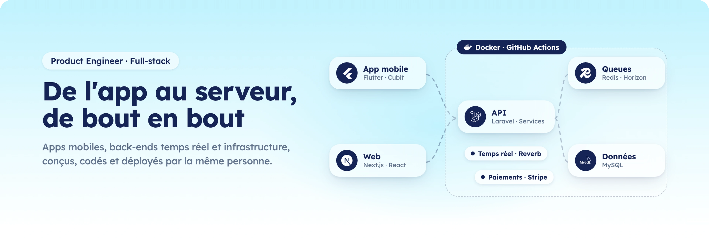

# SEGUIN Yannis

## Product Engineer & Fullstack Builder

Je ne me contente pas de coder, je transforme des besoins complexes en produits scalables et robustes. Fort d'une approche d'ingénierie pragmatique, je conçois l'architecture complète de vos solutions (Data, API, DevOps, Front) en privilégiant la vélocité et la solidité structurelle.

- Site web : https://seguin-dev.com
- LinkedIn : https://www.linkedin.com/in/yannis-seguin-540432161/

---

## Mon approche

- Architecture First : Conception rigoureuse des modèles de données et des flux.
- Vélocité Augmentée : Utilisation d'outils modernes et de l'IA pour une exécution et une livraison rapides.
- Business Centric : La technique au service exclusif de la valeur utilisateur et de l'efficacité métier.

---

## Mes impératifs

- L’organisation : Les projets doivent être cadrés dès le départ. Je refuse la navigation à vue pour garantir la maîtrise des délais et des coûts.
- La clarté : Je privilégie les architectures simples et éprouvées aux solutions complexes ou à la mode. L'efficacité prime sur le superflu.
- Le pragmatisme : Explorer de nouvelles technologies n'a de sens que si cela apporte un impact pratique direct. Pas de sur-ingénierie.
- La transparence : Les non-dits freinent le développement. J'entretiens des relations directes et transparentes, tant sur les choix techniques et l'avancement des projets qu'avec mes pairs.

---

## Stack & Architecture

- Mobile & Web : Flutter (Dart, Cubit/Bloc), React.js, Next.js, TailwindCSS
- Backend & Data : Node.js (TypeScript), Laravel (PHP), Reverb (WebSockets), Supabase, Firebase
- DevOps & Infrastructure : Docker, Coolify (Self-hosted), Hetzner, CI/CD GitHub Actions
- Fondamentaux : Ancien étudiant de l'École 42 (Algorithmique, rigueur système, C/C++)
